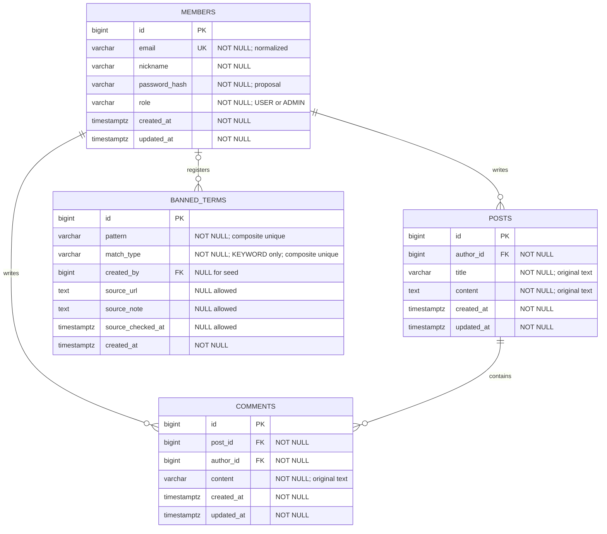

# note-demo 프로젝트 설계용 AI 에이전트 프롬프트

아래 구분선 이후 내용을 AI 에이전트에 전달하세요. 목적은 **alwaysdata 무료 플랜에 배포할 프로젝트의 설계**이며, 구현을 요청하기 전까지 애플리케이션 코드를 작성하지 않습니다. 배포 대상은 사용자 지정 사항이며, 기술 구성은 아래 배포 제약을 기준으로 설계합니다. 실제 작업 순서와 피드백은 별도 `implementation_plan.md`에서 관리합니다.

---

## 역할과 목표

당신은 요구사항 분석가이자 풀스택 소프트웨어 설계자입니다. 다음 요구사항을 기반으로 `note-demo`라는 회원 기반 게시판 서비스의 설계 문서를 작성하세요.

가장 중요한 목표는 원래 요구사항을 빠짐없이 반영하고, 명시된 요구사항과 설계자가 제안한 가정을 구분하는 것입니다. 데모/MVP에 맞는 단순한 구조를 우선하며, 향후 확장을 이유로 불필요한 인프라나 기능을 추가하지 마세요.

모든 설명은 한국어로 작성하고, API 경로·테이블명·필드명 등 식별자는 영어로 작성하세요.

## 배포 환경과 필수 설계 제약

- **배포 대상은 alwaysdata Free**입니다. 2026-10-27 확인 기준 공식 안내는 디스크 1 GB, RAM 256 MB, CPU 1/4, 백업 보관 3일이며 파일·메일·DB가 디스크 할당량을 공유합니다. 무료 플랜은 비영리 용도와 계정의 `alwaysdata.net` 웹 주소로 제한됩니다. 본 프로젝트는 비영리 학습/데모로 가정하며 실제 계정의 관리 화면에서 적용 한도를 다시 확인하세요. [공식 요금표](https://www.alwaysdata.com/en/offers/), [무료 플랜 조건과 할당량](https://help.alwaysdata.com/en/docs/admin-billing/billing/public-cloud-prices/)
- 구현 기준 구성은 **Python + Django + Django Templates + PostgreSQL**입니다. Python/Django/드라이버는 배포 계정에서 선택 가능한 호환 버전을 확인한 후 고정하세요. 운영 DB는 alwaysdata 관리형 PostgreSQL을 사용하며 DB 서버를 직접 설치하지 않습니다. [PostgreSQL 연결 안내](https://help.alwaysdata.com/en/docs/web-hosting/databases/postgresql/)
- alwaysdata의 **Python WSGI** 사이트로 `config/wsgi.py`를 실행합니다. 플랫폼이 uWSGI를 관리하므로 별도 Gunicorn/uWSGI 서버 설치, Docker, systemd, root 권한, 직접 Nginx 설치를 전제로 하지 마세요. `runserver`는 로컬 개발용입니다. SSH/venv/패키지 설치는 공식 안내의 `python` 명령을 사용하고 웹 사이트와 CLI의 Python 버전을 일치시키세요. [Python 구성 안내](https://help.alwaysdata.com/en/docs/web-hosting/languages/python/configuration/)
- 정적 파일은 `collectstatic`으로 모은 후 **WhiteNoise 미들웨어**로 제공합니다. 단일 WSGI 사이트로 동작하게 구성하고 별도 프론트 서버·Node 빌드·CDN·객체 저장소를 필수 의존성으로 추가하지 마세요. [WhiteNoise 공식 Django 안내](https://whitenoise.readthedocs.io/en/stable/django.html)
- 서버 렌더링 화면과 서버 세션을 사용합니다. Redis, Celery, 별도 작업 워커, WebSocket/ASGI는 현재 MVP에 포함하지 않습니다. 세션은 DB에 저장하고 만료 세션 정리 방법을 문서화하세요.
- HTTPS, `DEBUG=False`, 정확한 `ALLOWED_HOSTS`/`CSRF_TRUSTED_ORIGINS`, Secure 쿠키, 환경변수 기반 비밀키·DB 자격증명을 설계에 포함하세요. 프록시 HTTPS 인식은 alwaysdata의 전달 헤더 동작을 확인하고 설정하며 리다이렉트 루프를 검증하세요. [HTTP 스택 안내](https://help.alwaysdata.com/en/docs/web-hosting/sites/http-stack/)
- 코드·최소 의존성·작은 CSS·소규모 seed만 배포하세요. 첨부파일·이미지 업로드·대형 금칙어 데이터·로그 무제한 저장·서버 내 테스트 DB와 개발 도구 설치는 제외합니다. 로컬에서 테스트하고 운영 DB에는 배포 마이그레이션만 실행하세요.
- 자원 대응 기본안은 게시글 10개·댓글 20개 페이징, 초기 금칙어 200개 이하·총 규칙 500개 상한입니다. 이 수치는 플랫폼 제한이 아닌 프로젝트 제안이며 관리자/seed 등록 양쪽에 적용합니다. 실제 성능 측정과 사용자 피드백에 따라 조정하세요.
- 경로는 로컬 `C:\AI4\Day10\demo`와 배포 서버 `/home/<account>/apps/note-demo`를 분리하세요. Windows 가상환경은 업로드하지 말고 서버에서 생성하세요. 계정명·DB 호스트·DB명·비밀번호·도메인은 실제 설정값으로 주입하며 추정해 확정하지 마세요.
- 배포 절차에는 코드 전송, 서버 venv, 의존성 설치, DB 마이그레이션, 관리자/seed 초기화, 정적 파일 수집, WSGI 등록/재시작, HTTPS 점검, 로그 확인, 백업·복구를 포함하세요. 무료 자원 안에서 실행되는지는 실제 계정에서 측정한 뒤 판단하세요.

## 1. 요구사항 해석 규칙

- 아래 요구사항 ID를 모든 설계와 검증 기준에서 유지하세요.
- 각 항목의 상태를 `현재 필수`, `현재 Mock`, `향후 확장`, `미확정`으로 구분하세요.
- 원문에 없는 동작은 확정된 요구사항처럼 서술하지 말고 `제안` 또는 `가정`으로 표시하세요.
- 같은 기능의 화면, API, 데이터 모델, 권한, 검증 기준이 서로 일치해야 합니다.
- 외부 검색을 하지 않았다면 검색했다고 쓰지 마세요. 확인되지 않은 출처, 버전, 테스트 결과를 만들지 마세요.
- 이번 작업은 설계입니다. 명시적인 구현 요청 없이 프로젝트 생성, 패키지 설치, 서버 실행, 배포를 진행하지 마세요.

## 2. 원문에서 도출한 요구사항

| ID | 항목 | 현재 범위와 향후 범위 |
| --- | --- | --- |
| REQ-01 | 회원가입 | 현재는 이메일 주소, 이름(닉네임), 비밀번호를 입력받는 회원가입을 제공한다. |
| REQ-01A | SNS 로그인 | 향후 회원가입/로그인 방식을 SNS 로그인으로 대체할 수 있도록 인증과 회원 프로필의 책임을 분리한다. 실제 SNS 연동은 현재 범위에서 제외한다. |
| REQ-01B | 비밀번호 처리 | 원문은 비밀번호 암호화를 향후 작업으로 명시했다. 아래 비밀번호 처리 지침에 따라 원문과 보안 권고의 차이를 명확히 다룬다. |
| REQ-02 | 로그인 | 가입한 사용자가 로그인할 수 있다. |
| REQ-03 | 로그아웃 | 로그인한 사용자가 로그아웃할 수 있다. 인증 방식에 맞게 이후 인증 상태가 해제되는 동작을 정의한다. |
| REQ-04 | 비밀번호 찾기 | 현재는 Mock-up만 제공한다. 실제 메일 발송, 인증 토큰 발급, 비밀번호 변경은 구현하지 않는다. |
| REQ-05 | 게시판 기본 구조 | 게시글은 제목과 내용으로 구성한다. 게시글 작성 기능은 게시판 이용에 필요한 기본 기능으로 제안하고, 원문에서 명시되지 않았음을 표시한다. |
| REQ-05A | 목록 표시 | 목록에서 사용자에게 표시하는 게시글 정보는 제목만이다. 제목 선택에 필요한 내부 ID와 페이징 메타데이터는 허용하되 화면에 작성자·작성일·내용·미리보기를 임의로 추가하지 않는다. |
| REQ-05B | 페이징 | 기본적으로 한 페이지에 게시글 10개를 제공한다. |
| REQ-05C | 상세 조회 | 선택한 게시글의 제목과 내용을 확인할 수 있다. 댓글 조회 방식도 함께 정의한다. |
| REQ-05D | 수정·삭제 | 본인이 작성한 게시글만 수정하거나 삭제할 수 있다. 서버에서 작성자 권한을 검증한다. |
| REQ-05E | 댓글 | 댓글 기능을 제공한다. 작성·조회·수정·삭제 및 권한의 구체적 범위는 원문에 없으므로 최소 범위를 제안한다. |
| REQ-05F | 불쾌한 표현 마스킹 | 키워드 매핑 또는 정규식으로 불쾌한 표현을 탐지하고 마스킹한다. |
| REQ-05G | 초기 금칙어 | 인터넷 등 최신 정보를 참고하여 초기 금칙어 목록을 구성하는 절차를 설계한다. |
| REQ-05H | 금칙어 관리 | 관리자가 금칙어를 추가하거나 삭제할 수 있다. |

### 비밀번호 처리 지침

- 원문의 `향후 암호화`를 누락하거나, 이미 현재 필수로 확정된 것처럼 바꾸지 마세요.
- 인증용 비밀번호 저장에는 복호화 가능한 암호화보다 단방향 비밀번호 해시가 적합함을 설명하세요.
- 현재 단계부터 비밀번호 해시를 적용하는 안을 권고하되, 이를 `원문 대비 보안 보완 제안 / 확인 필요`로 표시하세요.
- 평문 저장을 기본 설계나 실행 가능한 예제로 제시하지 마세요. 미합의 상태에서는 저장 방식의 확정이 필요함을 기록하세요.
- 비밀번호 처리 책임을 별도 컴포넌트로 분리하고, 비밀번호·해시가 응답이나 로그에 노출되지 않도록 설계하세요.

## 3. 미정 사항을 처리하는 방법

다음 항목은 원문에 정답이 없습니다. 각 항목에 `추천안`, `이유`, `영향`, `확인 필요 여부`를 적으세요.

1. 배포 세부값: alwaysdata 계정명·주소, 사용 가능한 Python/PostgreSQL 버전, 실제 한도와 DB 접속 정보. 기술 구성은 위 배포 기준을 따를 것.
2. 인증: DB 세션을 기준으로 로그인 유지 기간과 로그아웃 시 무효화 동작 정의.
3. 조회 권한: 사용자 피드백에 따라 게시글 목록·상세·댓글은 로그인한 회원만 조회합니다. 첫 진입은 로그인 화면이며, 폼 아래에 회원가입 링크를 둡니다. 로그인 후 게시판으로, 로그아웃 후 로그인 화면으로 이동합니다.
4. 회원 정보: 이메일 중복 판정/정규화, 닉네임 중복 허용, 입력 길이와 형식.
5. 댓글 범위: 최소 권고안은 작성·조회·본인 삭제이며, 수정·대댓글·관리자 삭제는 별도 결정.
6. 페이징: 페이지 번호 시작값, 정렬 기준, 동일 정렬값의 순서, 빈 목록·범위 초과 요청 처리, 페이지 크기 변경 허용 여부와 상한.
7. 삭제 정책: 게시글/댓글의 물리 삭제 또는 논리 삭제, 게시글 삭제 시 댓글 처리.
8. 관리자: 관리자 식별 방식과 최초 관리자 생성 절차. 일반 회원가입으로 관리자 권한을 선택할 수 없도록 할 것.
9. 마스킹: 적용 대상, 적용 시점, 원문 보관 여부, 금칙어 변경 시 기존 데이터 반영 방식.
10. Mock 화면: 비밀번호 찾기 안내 문구와 응답 방식. 실제 메일이 발송되었다고 오인시키지 않을 것.

핵심 확인 질문은 최대 5개로 묶으세요. 답변 없이도 작성 가능한 설계는 명시적인 가정 아래 계속 작성하고, 실제 확정이 필요한 사항만 `미확정 결정`으로 남기세요. 질문만 제시하고 설계 전체를 중단하지 마세요.

## 4. 기능별 상세 설계 지침

### 4.1 회원과 인증

- 회원가입 필드, 필수 여부, 검증 규칙, 이메일 중복 처리와 실패 응답을 정의하세요.
- 로그인 성공·실패, 인증 만료, 로그아웃 전후의 동작을 정의하세요.
- 사용자 ID와 작성자 ID의 관계를 명시하세요. 작성자와 권한은 클라이언트가 보낸 값으로 신뢰하지 말고 서버의 인증 정보로 판정하세요.
- 향후 SNS 로그인으로 전환할 때 외부 제공자 식별자와 내부 회원 ID를 어떻게 연결할지 설명하세요. 기존 이메일 계정과의 연결 정책은 별도 확인 사항으로 남기세요.
- 비밀번호 찾기는 화면과 Mock 응답까지만 설계하고, 추후 실제 복구 흐름과 교체할 경계를 명시하세요.

### 4.2 게시글과 댓글

- 목록·상세·작성·수정·삭제의 입력, 출력, 인증·권한과 실패 조건을 정의하세요.
- 본인 글 수정·삭제는 UI 버튼 제어뿐 아니라 API에서 검증하세요.
- 게시글 제목·내용과 댓글의 입력 길이, 공백 처리, 빈 값 허용 여부를 제안하세요.
- 댓글의 작성자 권한, 게시글과의 관계, 존재하지 않거나 삭제된 게시글에 대한 동작을 정의하세요.
- 삭제된 데이터와 접근 권한이 없는 데이터의 오류 응답 정책을 일관되게 정하세요.

### 4.3 불쾌한 표현 마스킹

- 제목, 본문, 댓글을 각각 적용 대상으로 검토하고 추천안을 제시하세요. 닉네임 적용은 추가 가정으로 구분하세요.
- 저장 시 마스킹과 조회 시 마스킹을 비교하고 하나를 추천하세요. 원문 보관, 금칙어 변경의 소급 반영, 수정 화면/API에서의 원문 노출 정책을 함께 정의하세요.
- 금칙어는 데이터로 관리하고, 초기 seed 데이터와 관리자 변경 데이터를 어떻게 유지할지 정의하세요.
- 현재는 키워드 부분 일치만 지원하세요. REGEX는 향후 확장으로 분리하고 관리자 등록에서 거부하세요.
- 부분 일치·단어 단위 일치, 대소문자, Unicode 정규화, 띄어쓰기·특수문자 우회 대응 수준을 명시하세요. 모든 우회 표현을 완벽히 탐지한다고 약속하지 마세요.
- 중복 규칙과 겹치는 매칭의 처리 순서, 치환 문자열(예: `***`), 반복 적용의 결과를 정의하세요.
- 정규식의 유효성 검증·실행 제한은 향후 확장 항목에만 기록하고 현재 구현 작업에서 제외하세요.
- 오탐으로 정상 표현이 가려지는 사례와 규칙 삭제 후의 동작을 검증 기준에 포함하세요.
- 관리자 추가·삭제의 입력 검증, 중복 처리, 권한 거부, 변경 적용 시점과 캐시 사용 시 무효화 방법을 정의하세요.
- 마스킹은 XSS 방어와 별개입니다. 게시글 표시 방식과 출력 이스케이프 기준을 별도로 명시하세요.

### 4.4 초기 금칙어 조사

- 설계 단계에서는 조사 방법과 seed 형식, 검토 절차를 제시하세요. 전체 운영 목록 구축은 별도 구현 작업으로 구분하세요.
- 웹 검색이 가능하면 실제 출처를 확인하고, 출처 제목·URL·게시/수정일(확인 가능한 경우)·조회일·이용 조건을 기록하세요.
- `최신`이라는 이유만으로 개인의 임의 목록을 신뢰하지 마세요. 사용 맥락, 오탐 가능성, 재사용 가능 여부를 검토하세요.
- 웹 검색이 불가능하면 그 한계를 명시하고 소수의 테스트 예시만 제시하세요. 이를 검증된 최신 목록이나 운영용 완성 목록으로 표시하지 마세요.
- seed 예시는 JSON·CSV·SQL 중 하나로 제안하고, 출처/선정 근거를 연결하는 방법과 반복 실행 시 중복을 막는 방법을 설명하세요.
- 특정 집단을 지칭하는 일반 단어 자체를 맥락 없이 금칙어로 등록하지 마세요.

## 5. 산출물

다음 순서로 하나의 설계 문서를 작성하세요. 같은 설명을 여러 장에 길게 반복하지 말고 상호 참조하세요.

1. **프로젝트 목적과 범위**: 현재 필수, Mock, 향후 확장, 범위 외 항목.
2. **요구사항 추적표**: 요구사항 ID / 상태 / 반영 설계 / 화면·API / 검증 기준. 모든 ID를 포함할 것.
3. **가정과 확인 사항**: 확정 사항, 추천 가정, 미확정 결정을 구분하고 핵심 질문을 최대 5개로 정리.
4. **기술 스택과 아키텍처**: alwaysdata Python WSGI + Django Templates + 관리형 PostgreSQL 기준으로 Mermaid 구조도와 배포 구성을 제공. 불필요한 대안 스택 비교는 제외.
5. **데이터 모델**: Mermaid ERD, 테이블별 컬럼·타입·PK/FK·NULL·고유 제약·인덱스·삭제 관계. 관리자와 금칙어 모델을 포함. 아래 **8. 데이터 모델 초안**을 기준으로 작성하고, 변경이 필요하면 변경 이유와 영향을 명시할 것.
6. **화면과 사용자 흐름**: 회원가입, 로그인, 로그아웃, 비밀번호 찾기 Mock, 게시글 목록/상세/작성/수정, 댓글, 관리자 금칙어 관리. 화면별 접근 권한과 로딩·빈 화면·실패 상태 포함.
7. **API 명세**: 메서드·경로·목적·인증/권한·요청/응답 예시·상태 코드. 페이징 응답과 공통 오류 형식을 포함하고, 선택한 UI 구조에 불필요한 중복 API는 만들지 않을 것.
8. **핵심 처리 흐름**: 인증/로그아웃, 작성자 검증, 페이징, 마스킹, 금칙어 변경 반영. 필요한 곳에만 시퀀스 다이어그램 또는 의사코드 사용.
9. **보안과 예외 처리**: 비밀번호 결정 상태, 인증 정보 보관, 선택한 인증 방식에 맞는 CSRF 대책, XSS/SQL Injection 방어, 입력 검증, 민감정보 로그 제외, 권한 오류.
10. **수용 기준과 검증 시나리오**: 아래 항목을 포함한 Given/When/Then 또는 동등한 구체적 기준.
11. **구현 순서·배포·향후 확장**: 단계별 결과물과 완료 기준, alwaysdata 설정·배포·재시작·정적 파일·로그·용량·복구 절차, SNS 로그인·비밀번호 처리·비밀번호 찾기 실구현 시 변경 지점. 실제 실행 계획은 별도 `implementation_plan.md`에 정리.

## 6. 반드시 포함할 검증 시나리오

- 정상 회원가입, 중복 이메일, 유효하지 않은 입력.
- 정상/실패 로그인, 로그아웃 이후 보호 기능 접근 거부.
- 비밀번호 찾기 Mock이 실제 이메일/비밀번호 변경을 수행하지 않으며 Mock 안내를 제공함.
- 게시글 목록에 제목 외 게시글 정보가 표시되지 않음.
- 데이터가 0개, 10개, 11개일 때 기본 페이지 크기와 페이지 이동이 정확함.
- 동일 정렬값이 있는 게시글도 고정된 기준으로 정렬됨.
- 본인 글 수정·삭제 성공, 타인 글에 대한 직접 API 요청 거부.
- 채택한 댓글 범위의 정상 처리와 권한 거부, 게시글 삭제 후 댓글 처리.
- 마스킹 적용 대상으로 정한 각 필드에서 금칙어가 정한 정책대로 치환됨.
- 정상 단어, 겹치는 규칙, 중복 등록, 금칙어 추가·삭제 후 기존 글의 표시 결과.
- 일반 사용자의 관리자 API 직접 호출 거부와 관리자 금칙어 추가·삭제 성공.
- 존재하지 않는 리소스, 잘못된 페이징 값, 빈 입력에 대한 일관된 오류 처리.
- 비밀번호 또는 해시가 API 응답과 로그에 포함되지 않음.
- alwaysdata WSGI 재시작 후에도 저장 데이터가 유지되고 HTTPS에서 로그인·로그아웃·CSRF 검증·정적 CSS가 정상 동작함.
- 운영 호스트·프록시 설정에 리다이렉트 루프가 없고 DEBUG 화면이 노출되지 않음.
- 소규모 데모 실행 시 실제 메모리·디스크 사용이 계정 한도 이내이고 세션/로그 정리 절차가 있음.

각 시나리오를 요구사항 ID 또는 명시한 가정과 연결하세요. 설계 단계에서는 테스트를 실행했다고 표현하지 말고, 향후 구현의 검증 기준으로 제시하세요.

## 7. 완료 전 자체 점검

- 모든 REQ ID가 추적표와 설계에 연결되어 있는가?
- 향후 기능이 현재 구현 범위로 섞이지 않았는가?
- 원문 대비 보완 제안과 미확정 사항을 명확히 표시했는가?
- 목록 제목만 표시, 기본 10개, 본인 글 권한 검증, 댓글, 마스킹, 관리자 추가·삭제가 모두 반영되었는가?
- 선택한 인증·삭제·마스킹 정책이 데이터 모델, API, 화면, 검증 기준에서 일치하는가?
- 확인되지 않은 검색 결과나 출처, 실행 결과를 사실처럼 쓰지 않았는가?
- 항상 실행할 별도 서버나 관리자 권한 없이 alwaysdata Python WSGI 사이트에서 배포 가능한가?

이 점검을 마친 뒤 완성된 설계 문서를 제시하고, 마지막에 사용자가 결정해야 할 미확정 사항만 짧게 정리하세요.

## 8. 데이터 모델 초안 — Mermaid ERD

이 절은 프로젝트의 구체적인 설계 초안입니다. 원문에서 확정하지 않은 항목은 아래 가정에 따라 제안한 것이며, 최종 설계 시 확인 사항으로 유지하세요.

### 8.1 설계 가정

- 타입은 alwaysdata 관리형 PostgreSQL을 기준으로 합니다. 기존 PK/FK·제약·인덱스 구조를 유지하며, 플랫폼이 PostgreSQL을 지원하므로 SQLite로 임의 변경하지 않습니다.
- 관리자는 별도 회원 테이블을 만들지 않고 `members.role = 'ADMIN'`으로 구분합니다. 일반 회원의 기본 역할은 `USER`입니다.
- `password_hash`는 현재부터 안전한 비밀번호 해시를 적용하는 보완 제안을 전제로 합니다. 원문의 `향후 암호화`와 차이가 있으므로 확정이 필요하며, 평문 저장을 의미하지 않습니다.
- 게시글과 댓글은 물리 삭제를 제안합니다. 게시글 삭제 시 해당 댓글도 삭제하며, 회원 탈퇴는 현재 범위에 포함하지 않습니다.
- 제목·본문·댓글 원문을 저장하고 조회 응답에서 마스킹하는 안을 제안합니다. 금칙어 추가·삭제 후 다음 조회부터 변경된 규칙을 적용하고, 캐시가 있다면 변경 시 무효화합니다. 공개 API는 저장 원문을 반환하지 않으며, 작성자의 편집용 원문 제공 정책은 별도 확정합니다.
- 금칙어는 현재 `KEYWORD` 유형만 허용하며 일치 구간을 `***`로 치환합니다. REGEX 지원은 현재 범위에서 제외합니다.
- SNS 계정 연결과 실제 비밀번호 복구는 향후 확장이므로 현재 ERD에 해당 테이블을 포함하지 않습니다. Django DB 세션 테이블은 기술 지원 테이블로 별도 관리합니다.

### 8.2 ERD

관계 해석: 회원 한 명은 게시글과 댓글을 각각 0개 이상 작성합니다. 게시글 한 개에는 댓글이 0개 이상 연결됩니다. 금칙어 한 개는 등록 관리자 한 명 또는 초기 seed에 의해 생성되며, seed에는 등록 회원이 없어도 됩니다. `registers` 관계 자체는 관리자 역할을 강제하지 않으므로 서비스 계층에서 `ADMIN` 권한을 검증해야 합니다.

### 8.3 테이블 정의

모든 `id`는 자동 생성하는 `BIGINT` PK이며 NULL을 허용하지 않습니다. 시간은 시간대가 있는 타입으로 저장하고 표시 시 사용자 시간대로 변환합니다. `created_at`의 기본값은 생성 시각이며, `updated_at`은 생성 시 초기화하고 변경 시 애플리케이션에서 갱신합니다.

#### members — 회원과 관리자

| 컬럼 | 타입 | NULL | 제약·기본값 | 의미 |
| --- | --- | --- | --- | --- |
| id | BIGINT | 불가 | PK, 자동 생성 | 내부 회원 식별자 |
| email | VARCHAR(254) | 불가 | UNIQUE | 앞뒤 공백 제거·소문자 변환을 제안하며, 동일 규칙을 가입/로그인에 적용 |
| nickname | VARCHAR(50) | 불가 | 공백만 입력 금지 | 이름(닉네임), 중복 허용 제안 |
| password_hash | VARCHAR(255) | 불가 | 보안 보완안 확정 필요 | 비밀번호 해시; 응답·로그 제외 |
| role | VARCHAR(10) | 불가 | DEFAULT 'USER', CHECK: USER/ADMIN | 회원/관리자 구분 |
| created_at | TIMESTAMPTZ | 불가 | DEFAULT CURRENT_TIMESTAMP | 가입 시각 |
| updated_at | TIMESTAMPTZ | 불가 | 생성 시 초기화, 변경 시 갱신 | 수정 시각 |

관리자 생성은 별도의 초기화 절차에서 수행하고, 회원가입 요청에서 `role`을 입력받지 않습니다. 역할 변경 UI/API는 현재 범위에 추가하지 않습니다.

#### posts — 게시글

| 컬럼 | 타입 | NULL | 제약·기본값 | 의미 |
| --- | --- | --- | --- | --- |
| id | BIGINT | 불가 | PK, 자동 생성 | 게시글 식별자 |
| author_id | BIGINT | 불가 | FK → members.id | 인증 정보로 지정하는 작성자 |
| title | VARCHAR(200) | 불가 | 공백만 입력 금지 | 제목 원문 |
| content | TEXT | 불가 | 공백만 입력 금지, 최대 20,000자 제안 | 본문 원문 |
| created_at | TIMESTAMPTZ | 불가 | DEFAULT CURRENT_TIMESTAMP | 작성 시각 |
| updated_at | TIMESTAMPTZ | 불가 | 생성 시 초기화, 변경 시 갱신 | 수정 시각 |

목록 화면에는 마스킹한 제목만 표시합니다. `id`는 상세 이동에, 시각은 정렬에 사용하며 화면의 목록 정보로 노출하지 않습니다. 본문 길이는 API에서 검증하고 DB에도 동일한 길이 CHECK를 적용합니다.

#### comments — 댓글

| 컬럼 | 타입 | NULL | 제약·기본값 | 의미 |
| --- | --- | --- | --- | --- |
| id | BIGINT | 불가 | PK, 자동 생성 | 댓글 식별자 |
| post_id | BIGINT | 불가 | FK → posts.id | 소속 게시글 |
| author_id | BIGINT | 불가 | FK → members.id | 인증 정보로 지정하는 작성자 |
| content | VARCHAR(1000) | 불가 | 공백만 입력 금지 | 댓글 원문 |
| created_at | TIMESTAMPTZ | 불가 | DEFAULT CURRENT_TIMESTAMP | 작성 시각 |
| updated_at | TIMESTAMPTZ | 불가 | 생성 시 초기화, 변경 시 갱신 | 향후 수정 지원 시 사용 |

댓글은 작성·조회·본인 삭제를 최소 범위로 제안합니다. 조회는 `comment_page`로 20개씩 처리해 전체 로딩을 피하며, 대댓글은 현재 모델에 포함하지 않습니다.

#### banned_terms — 금칙어 규칙

| 컬럼 | 타입 | NULL | 제약·기본값 | 의미 |
| --- | --- | --- | --- | --- |
| id | BIGINT | 불가 | PK, 자동 생성 | 규칙 식별자 |
| pattern | VARCHAR(500) | 불가 | 공백만 입력 금지 | 탐지 키워드 |
| match_type | VARCHAR(10) | 불가 | DEFAULT 'KEYWORD', CHECK: KEYWORD만 허용 | 향후 확장용 탐지 방식 구분 |
| created_by | BIGINT | 허용 | FK → members.id | 등록 관리자; 초기 seed는 NULL |
| source_url | TEXT | 허용 | 확인 가능한 경우에만 저장 | 초기 규칙의 출처 링크 |
| source_note | TEXT | 허용 | — | 출처 제목, 선정 근거, 이용 조건 등 |
| source_checked_at | TIMESTAMPTZ | 허용 | — | 출처를 실제 확인한 시각 |
| created_at | TIMESTAMPTZ | 불가 | DEFAULT CURRENT_TIMESTAMP | 등록 시각 |

`UNIQUE(match_type, pattern)`으로 동일 유형의 동일 규칙 중복을 막습니다. 키워드는 정한 정규화 규칙을 적용한 뒤 저장하고 검사합니다. 정규식 등록은 현재 거부하며, 향후 지원 시 CHECK와 검증 로직을 함께 변경합니다. 관리자 수동 등록 규칙은 출처가 없을 수 있지만, 조사 기반 초기 seed에는 출처나 검증 한계를 기록합니다.

### 8.4 인덱스와 삭제 관계

| 테이블 | 인덱스 | 목적 |
| --- | --- | --- |
| members | PK(id), UNIQUE(email) | 회원 조회, 로그인, 이메일 중복 방지 |
| posts | PK(id), INDEX(created_at DESC, id DESC) | 최신순 목록과 안정적인 동률 정렬 |
| posts | INDEX(author_id) | 작성자 관계 조회와 FK 참조 확인 |
| comments | PK(id), INDEX(post_id, created_at, id) | 게시글별 댓글 조회 및 작성순 정렬; post_id FK 인덱스 겸용 |
| comments | INDEX(author_id) | 작성자 관계 조회와 FK 참조 확인 |
| banned_terms | PK(id), UNIQUE(match_type, pattern) | 규칙 조회와 중복 방지 |
| banned_terms | INDEX(created_by) | 등록자 관계 조회와 FK 참조 확인 |

| 외래 키 | ON DELETE | 동작 |
| --- | --- | --- |
| posts.author_id → members.id | RESTRICT | 작성 게시글이 있는 회원의 물리 삭제 방지 |
| comments.author_id → members.id | RESTRICT | 작성 댓글이 있는 회원의 물리 삭제 방지 |
| comments.post_id → posts.id | CASCADE | 게시글 삭제 시 소속 댓글 함께 삭제 |
| banned_terms.created_by → members.id | SET NULL | 등록 회원 삭제 시 규칙은 보존 |

PK는 변경하지 않으며 FK 갱신은 `ON UPDATE NO ACTION`을 전제로 합니다. 금칙어 삭제는 규칙 행의 물리 삭제이며 게시글/댓글 데이터에는 연쇄 삭제를 적용하지 않습니다. 회원 탈퇴를 향후 도입할 때는 익명화·개인정보 보관·작성물 보존 정책을 함께 재설계해야 합니다.

### 8.5 DB 제약과 애플리케이션 검증의 경계

- DB는 PK/FK, NULL, UNIQUE, 역할/규칙 유형 CHECK와 길이·공백 제약을 담당합니다.
- 애플리케이션은 이메일 형식/정규화, 비밀번호 정책, 작성자 일치, 관리자 권한, 키워드 정규화, 미지원 규칙 유형 거부, 마스킹 적용을 담당합니다.
- `created_by`가 NULL인 seed는 일반 관리자 등록 API가 아니라 초기화 경로에서만 생성합니다. 관리자 등록 시 등록자는 인증 정보로 설정합니다.
- 현재 ERD는 동시 편집 충돌 감지와 변경 이력 보관을 포함하지 않습니다. 필요하면 별도 요구사항으로 추가합니다.
