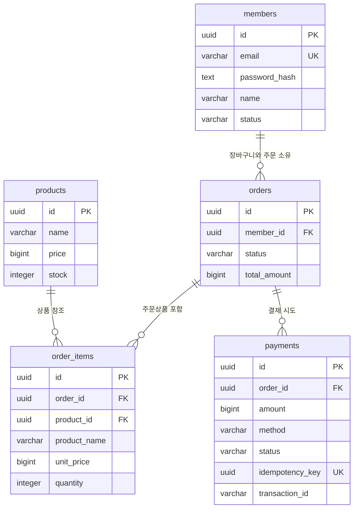

# 쇼핑몰 ERD — 최소 구성

단계 1 수정 제안입니다. [스키마 이전 안내](schema-migration.md)를 참고하세요. **필수 4개 테이블 + 주문상품 1개 = 총 5개**로 구성합니다. 모든 테이블은 전용 스키마 `shoppingmall`에 속합니다. 사용자는 기존 SQL을 public에 적용했으며, 이번 변경은 로컬 파일에만 반영했습니다.

## 가정

- 금액은 원(KRW) 단위 정수이며 배송비·할인·환불은 다루지 않습니다.
- 비회원은 상품을 조회하고 선택할 수 있습니다. **장바구니 저장부터 로그인**하며 비회원 장바구니 저장·병합은 생략합니다. 선택 상품·수량이 담긴 내부 URL을 next로 보존합니다.
- 상품당 수량은 1~99개이며 결제 시 재고를 최종 확인합니다.
- 이전 제안의 cart_merge_receipts는 제외합니다. 기존 public에 해당 테이블이 남아 있다면 이전 안내를 따릅니다.

## 관계도

읽기 쉽게 주요 컬럼만 표시합니다. 전체 컬럼은 [테이블 정의서](table-definition.md), Mermaid 원문은 [erd.mmd](erd.mmd)에 있습니다.

`||`는 정확히 1개, `o{`는 0개 이상입니다. 주문 생성 시에는 서비스에서 주문상품이 최소 1개인지 검사합니다.

## 테이블별 역할

| 테이블 | 역할 | 필요한 이유 |
| --- | --- | --- |
| members | 회원·로그인·개인정보 | 주문한 회원 식별 |
| products | 상품·현재 가격·재고 | 상품 조회와 판매 수량 관리 |
| orders | 장바구니와 주문 | 상태로 장바구니·결제 전·완료 구분 |
| order_items | 주문별 상품·수량·가격 | 주문과 상품의 N:M 해소, 당시 가격 보존 |
| payments | 모의 결제 결과 | 결제수단·상태·거래ID 및 재시도 기록 |

## 상태와 핵심 규칙

| 대상 | 상태 흐름 |
| --- | --- |
| 주문 | CART → PENDING → PAID |
| 미결제 주문 | CART 또는 PENDING → CANCELED (탈퇴 시 정리) |
| 결제 시도 | PENDING → SUCCEEDED 또는 FAILED |
| 회원 | ACTIVE → WITHDRAWN |

- 회원별 CART는 최대 1개입니다. 주문으로 바뀌어도 주문 ID는 같습니다.
- 주문 생성 시 상품명·가격을 확정합니다. 이후 상품 가격이 바뀌어도 주문상품은 유지합니다.
- 주문당 결제 시도는 여러 번 가능하지만 성공은 1번만 허용합니다.
- 재고는 결제 성공 시에만 차감하며 결제·주문 상태와 함께 하나의 트랜잭션으로 저장합니다.
- 회원 → 주문 → 상품 순서로 행을 잠그며 여러 상품은 ID 순서로 잠급니다. 서비스에서 소유권·금액·재고·상태를 검사합니다.
- 탈퇴 시 회원 개인정보를 익명화하고 주문 배송정보를 지웁니다. 상품·금액·결제 기록은 보존합니다. 실제 운영 보존 정책은 별도 확정이 필요합니다.

실제 값의 변화는 [상품 구매 시뮬레이션](purchase-simulation.md)을 읽으세요.

