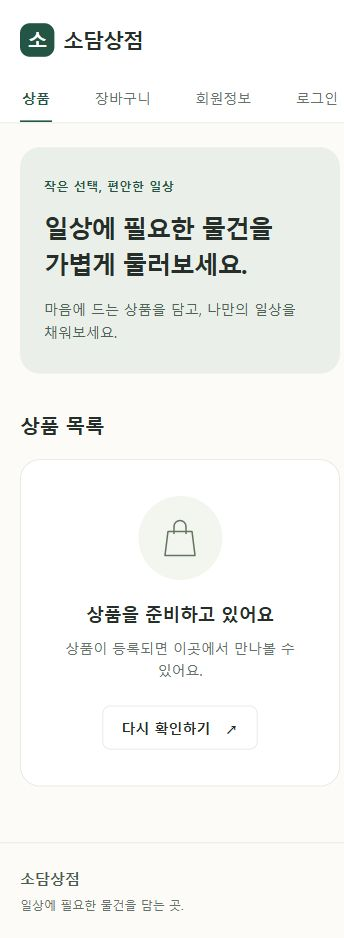
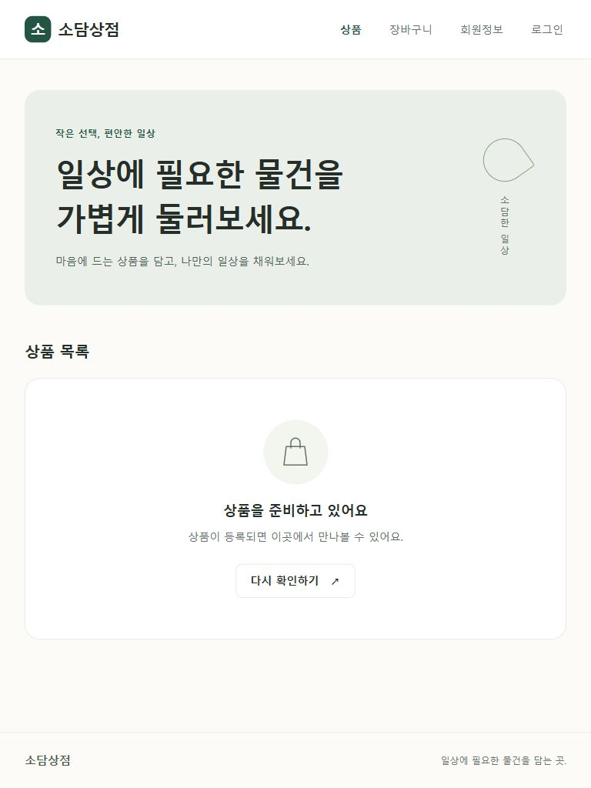
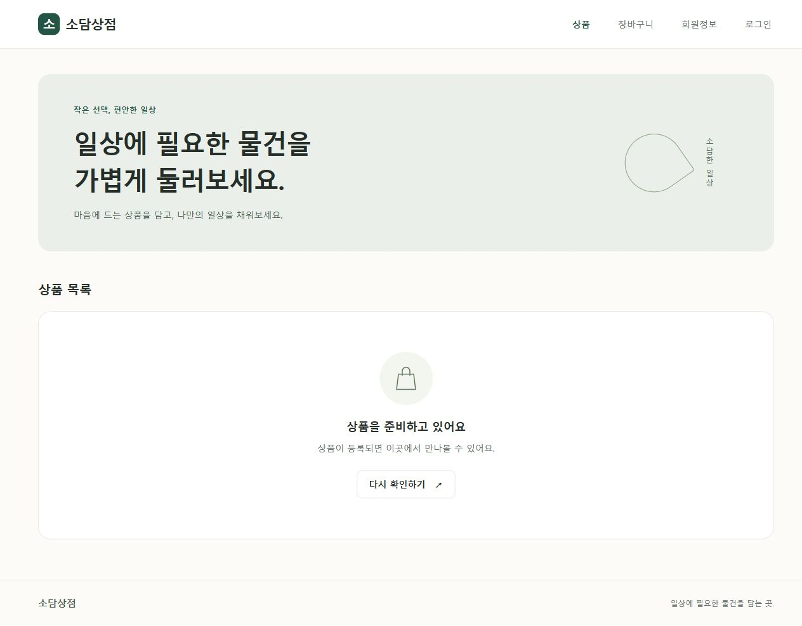

# 단계 2 결과 — 골격·DB 연결·공통 화면

이 문서는 단계 2 완료 당시의 기록입니다. 이후 인증 구현까지 완료했으며 최신 내용은 [단계 3 결과](stage3.md)에서 확인합니다.

## 적용한 가정

- 임시 상점 이름은 `소담상점`이며 환경변수로 바꿀 수 있습니다.
- DB 비밀값이 없어도 공통 화면을 검토할 수 있도록 DB 연결은 실제 사용 시 수행합니다. 운영 환경은 DATABASE_URL 미설정을 거부합니다.
- 상품 데이터 조회는 단계 4입니다. 현재 상품 화면은 공통 레이아웃용 빈 상태로, DB에 상품이 없다는 조회 결과를 뜻하지 않습니다.
- 아직 구현하지 않은 장바구니·회원정보·로그인 메뉴는 링크 대신 준비 중 상태로 표시합니다.

## 파일과 목적

| 파일 | 목적 |
| --- | --- |
| app/main.py | 앱 생성, 수명주기, 정적 파일, 허용 호스트 설정 |
| app/core/config.py | .env 읽기, 비밀값 보호, URL·TLS·운영 설정 검증 |
| app/core/db.py | psycopg 연결 풀·요청별 세션·shoppingmall 공통 메타데이터 |
| app/core/check_db.py | 비밀값 출력 없이 필수 테이블 접근을 확인하는 CLI |
| app/models.py | 기존 5개 테이블·56개 컬럼과 FK의 ORM 매핑 |
| app/routers/pages.py | / → /products 이동, 공통 화면 렌더링 |
| app/templates/base.html | 공통 헤더·메뉴·본문·푸터·viewport |
| app/templates/products.html | DB 조회 전 상품 화면 레이아웃 |
| app/static/css/style.css | Mobile First, 768px·1024px 미디어 쿼리 |
| app/static/js/.gitkeep | 이후 Vanilla JavaScript 파일을 둘 빈 폴더 유지 |
| app 및 하위 패키지의 __init__.py | core·routers·schemas·services 패키지 골격 |
| requirements.txt | 서버·템플릿·DB·설정 의존성 |
| requirements-dev.txt | HTTP 테스트용 개발 의존성 |
| .env.example | 비밀값 없는 설정 예시 |
| .gitignore | .env·가상환경·캐시 제외 |
| .vscode/settings.json, launch.json | Python 인터프리터·Uvicorn 디버깅 설정 |
| tests/test_foundation.py, tests/__init__.py | 기반 동작·보안 설정·스키마 매핑 검증 |
| README.md | 로컬 실행·환경변수·DB 확인·테스트 안내 |
| docs/plan.md | 현재 진행 상태 반영 |
| docs/stage2.md, docs/screenshots/ | 단계 결과와 실제 브라우저 캡처 |

db/schema.sql을 포함한 기존 DDL은 이번 단계에서 변경하거나 실행하지 않았습니다. ORM은 기존 DB를 사용하는 매핑이며 별도 DDL 생성 기능은 제공하지 않습니다. 인덱스·CHECK·UNIQUE·트리거·RLS의 기준은 기존 schema.sql입니다.

## 검증 결과

- Python 3.12 프로젝트 가상환경에서 의존성 설치, `pip check` 통과
- 최초 `unittest` 7개 통과, 이후 분리된 DB 설정 검증 추가로 총 9개 통과, Python 소스 컴파일 통과
- Uvicorn `--reload` 시작, `/products` 및 CSS의 실제 브라우저 로딩 확인
- 360px / 768px / 1280px에서 미디어 쿼리·화면을 점검하고 가로 넘침 없음 확인
- 테스트에서 5개 테이블의 56개 컬럼과 모든 FK가 shoppingmall 스키마를 사용하는지 확인
- `.env`를 생성하거나 실제 비밀값을 저장하지 않음

8000 포트는 현재 Windows 환경에서 WinError 10013으로 바인딩이 거부되어 8012 포트를 사용했습니다. 검증 후 개발 서버는 종료했습니다. [README 실행 안내](../README.md)로 다시 실행할 수 있습니다.

## 실제 DB 연결 추가 확인

초기에는 연결정보가 없어 실제 DB 연결을 검증하지 못했으나, 사용자가 작성한 `.env`의 분리 설정을 지원하도록 수정한 뒤 **Supabase TLS 연결과 shoppingmall 필수 테이블 5개 읽기를 확인했습니다.** 원격 데이터·스키마는 변경하지 않았습니다. [DB 연결 결과](db-connection.md)를 참고하세요.

회원가입·로그인·로그아웃·세션·CSRF·next 로직은 다음 단계입니다. 이후 단계의 기능과 최종 구매 흐름은 이번 검증에 포함되지 않습니다.

## 실제 화면

### 360px

### 768px

### 1280px

## 구현 참고 문서

- [FastAPI 템플릿·정적 파일](https://fastapi.tiangolo.com/advanced/templates/)
- [Pydantic 환경설정](https://docs.pydantic.dev/latest/concepts/pydantic_settings/)
- [SQLAlchemy psycopg 연결](https://docs.sqlalchemy.org/en/20/dialects/postgresql.html#module-sqlalchemy.dialects.postgresql.psycopg)
