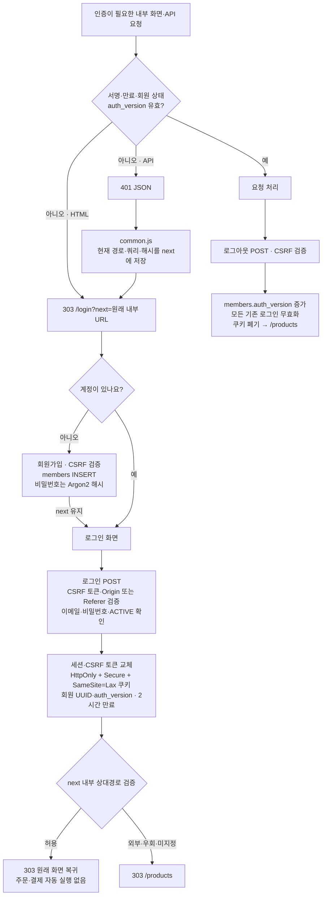
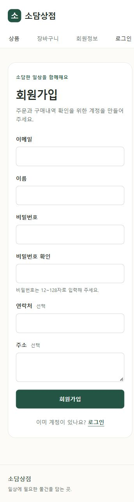
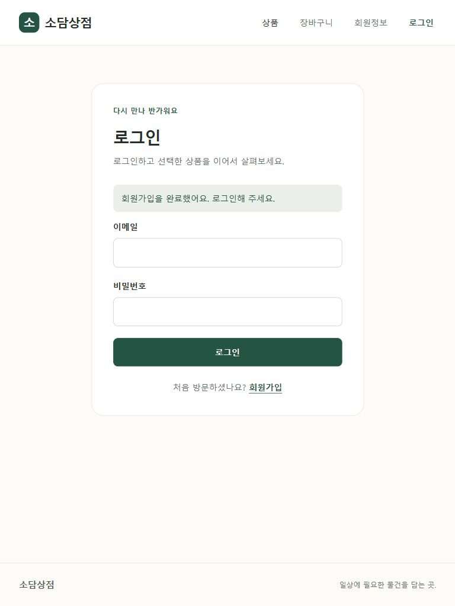
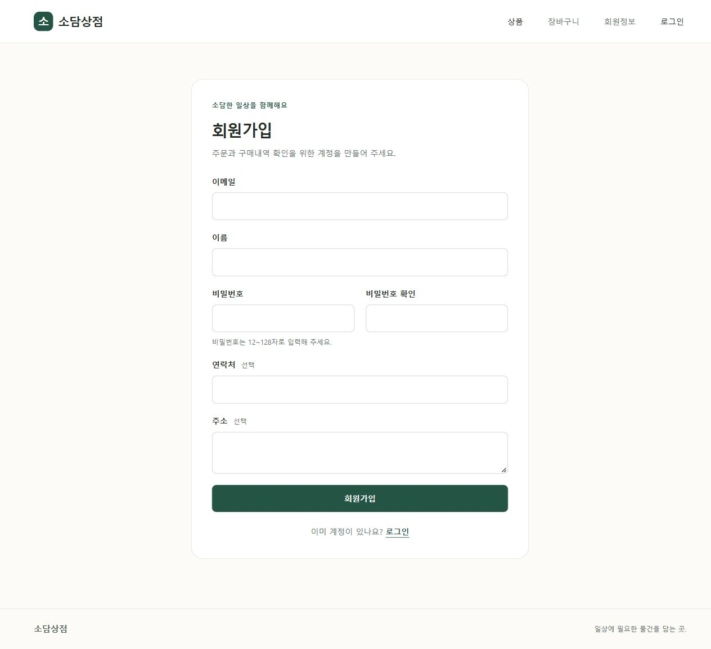

# 단계 3 결과 — 인증과 로그인 복귀

이 문서는 단계 3 완료 당시의 기록입니다. 회원가입·로그인·로그아웃·쿠키 세션·CSRF·next 복귀를 구현했으며, 이후 구매 기능은 [단계 4 결과](stage4.md)에 정리했습니다.

## 적용 가정

- 비밀번호는 12~128자, 가입 후 로그인 화면으로 이동합니다. 로그인 때는 기존 비밀번호 검증을 위해 길이 1~128자를 허용합니다.
- 서명 세션은 발급 후 2시간 유효하며 회원 UUID·auth_version·CSRF 토큰만 저장합니다. 서명은 암호화가 아니므로 비밀번호·이메일·주소는 넣지 않습니다.
- 세션 테이블을 추가하지 않습니다. 로그아웃 시 auth_version을 증가시켜 다른 브라우저의 기존 로그인도 무효화합니다.
- 기본 쿠키는 HttpOnly·Secure·SameSite=Lax입니다. 현재 .env는 로컬 HTTP 개발용 COOKIE_SECURE=false를 명시했고, HTTPS·운영 환경에서는 이 예외를 허용하지 않습니다.
- 기존 DB 설정을 유지하면서 SESSION_SECRET을 생성하고 APP_BASE_URL을 실제 로컬 포트 8012에 맞췄습니다. 비밀값은 출력하지 않았습니다.

## 인증 흐름

[Mermaid 원문](auth-flow.mmd)을 제공합니다. 그림의 인증 의존성은 이후 장바구니·결제·회원정보 화면에도 적용합니다. 그 화면 자체는 이번 단계에서 구현하지 않았습니다.

## 보안과 동작

- 비밀번호는 Argon2id로 해시합니다. 존재하지 않는 이메일에도 해시 검증을 수행하고 로그인 오류 메시지를 통일합니다.
- Pydantic이 이메일·이름·비밀번호·연락처·주소의 형식·길이와 비밀번호 확인을 검증합니다. 오류 화면에 비밀번호를 다시 표시하지 않습니다.
- GET /register, GET /login으로 폼을 제공하고 POST로 처리합니다. POST /logout만 허용합니다. GET /api/auth/me는 로그인 회원의 ID·이메일·이름만 반환하며 미인증 시 401입니다.
- 로그인 성공 시 기존 익명 세션을 비우고 회원 정보와 CSRF 토큰을 새로 발급합니다. 매 요청마다 DB 회원 상태와 auth_version을 다시 확인합니다.
- 모든 POST/PUT/PATCH/DELETE에 세션 연결 CSRF 토큰과 Origin을 검사합니다. Origin이 없을 때만 Referer를 확인하며 둘 다 없으면 거부합니다. CSRF 토큰은 폼 숨김 필드 또는 X-CSRF-Token으로 전달합니다.
- next는 단일 /로 시작하는 내부 경로만 허용합니다. 외부 도메인·//·역슬래시·제어문자·인코딩 우회·점 경로·인증 페이지 복귀 루프를 거부합니다. 미지정·거부 시 /products로 보냅니다.
- 가입 화면과 로그인 화면을 전환해도 next를 유지합니다. 로그인 POST의 hidden next도 신뢰하지 않고 서버에서 다시 검사합니다.
- 공통 apiFetch는 같은 출처만 호출하고 401이면 현재 경로·쿼리·해시를 next로 전달합니다. 상태 변경에 CSRF 헤더를 추가하고 인증 토큰을 localStorage에 저장하지 않습니다.
- SQLAlchemy 매개변수 바인딩을 사용하고 DB 장애는 비밀값 없는 503 응답으로 처리합니다. 인증 HTML·JSON 응답에 Cache-Control: no-store를 적용합니다.

## 변경 파일과 이유

| 파일 | 이유 |
| --- | --- |
| app/core/security.py | 비밀번호 해시·검증, 안전한 next, 세션 교체, CSRF 미들웨어 |
| app/core/auth.py | 선택·필수 인증 의존성, 회원 상태·인증 버전 확인 |
| app/core/templates.py | 공통 CSRF 메타 정보·로그인 복귀 링크 전달 |
| app/core/config.py | 모든 환경의 세션 비밀값 검증, 로컬 HTTP 쿠키 예외 제한 |
| app/core/setup_local.py | 기존 DB 정보를 유지하며 누락된 개발용 세션 설정 보완 |
| app/core/db.py | 같은 요청의 인증 검사와 서비스가 DB 세션을 공유하도록 구성 |
| app/main.py | 세션·CSRF·허용 호스트 미들웨어 및 인증·DB 오류 응답 연결 |
| app/schemas/auth.py | 가입·로그인 Pydantic 검증 |
| app/services/auth.py | 회원 생성·비밀번호 검증·해시 갱신 |
| app/routers/auth.py | 가입·로그인·로그아웃·현재 회원 API |
| app/routers/pages.py | 상품 공통 화면에 로그인 상태 반영 |
| app/templates/base.html | 실제 로그인 링크·CSRF 로그아웃 폼·공통 JS |
| app/templates/login.html, register.html | 모바일 우선 인증 폼·입력 오류·가입 완료 안내 |
| app/static/css/style.css | 인증 카드·폼·오류·버튼의 반응형 스타일 |
| app/static/js/common.js | API 401 복귀 및 상태 변경 CSRF 헤더 |
| requirements.txt | Argon2·서명 세션·폼·이메일 검증 의존성 추가 |
| .env.example | 필수 세션 키와 로컬 HTTP 설정 안내 |
| .env (Git 제외) | 실제 DB 값을 보존하고 개발용 인증 설정 추가 |
| tests/test_auth.py, auth_support.py | 메모리 DB에서 인증·보안 회귀 검증 |
| tests/test_foundation.py | 필수 세션 비밀값을 사용하는 테스트 설정 |
| tests/check_auth_db.py | 외부 트랜잭션 롤백 방식으로 Supabase 통합 검증 |
| tests/preview_auth.py | 실제 DB에 쓰지 않는 브라우저 검증 서버·401 버튼 |
| README.md, docs/plan.md, docs/table-definition.md | 실행·단계·로그아웃 버전 정책 반영 |
| docs/stage3.md, auth-flow.mmd, screenshots/stage3-*.jpg | 결과·흐름·실제 캡처 |

기존 SQL DDL과 테이블 구조는 바꾸지 않았습니다.

## 확인 결과

- 자동 테스트 22개 통과: 가입·해시·이메일 정규화·중복·로그인·복귀·로그아웃·CSRF·쿠키 플래그·만료·변조·이전 쿠키 거부·회원 상태 검증 포함
- 실제 Supabase에서 임시 회원을 사용해 가입·중복 방지·로그인·복귀·로그아웃·인증 버전 변경·이전 쿠키 거부 검증
- 위 통합 검증의 모든 쓰기를 외부 트랜잭션으로 감싸 롤백, 테스트 회원이 남지 않음을 확인
- 브라우저에서는 Supabase 대신 독립 메모리 DB를 사용해 가입·로그인·쿼리 유지 복귀·로그아웃 확인
- 실제 common.js가 API 401을 받고 로그인으로 이동한 뒤 원래 경로·쿼리로 돌아오는 것을 브라우저에서 확인
- 360px 회원가입, 768px 로그인, 1280px 회원가입 화면에서 가로 넘침 없음 확인

장바구니·결제 화면으로의 실제 복귀는 단계 4 구현 후 확인합니다. 회원정보 수정·비밀번호 변경·탈퇴 화면은 단계 5입니다. 로그인 버전 무효화 기반은 이번 단계에서 준비했습니다.

## 실제 화면

## 참고

- [FastAPI 비밀번호 해시 안내](https://fastapi.tiangolo.com/tutorial/security/oauth2-jwt/)
- [OWASP CSRF 방어 안내](https://cheatsheetseries.owasp.org/cheatsheets/Cross-Site_Request_Forgery_Prevention_Cheat_Sheet.html)

세션 쿠키의 실제 동작은 설치된 Starlette SessionMiddleware 소스에서도 확인했습니다. 예제 JWT 대신 프로젝트 요구에 맞춰 서명된 HttpOnly 세션을 사용합니다.

