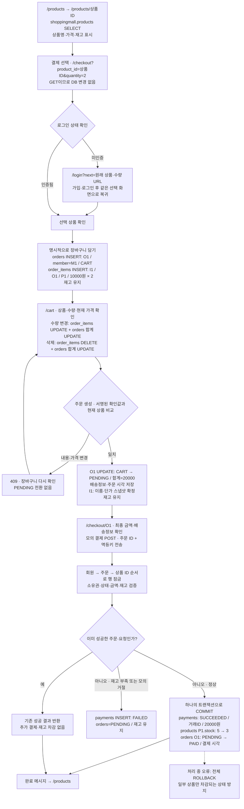
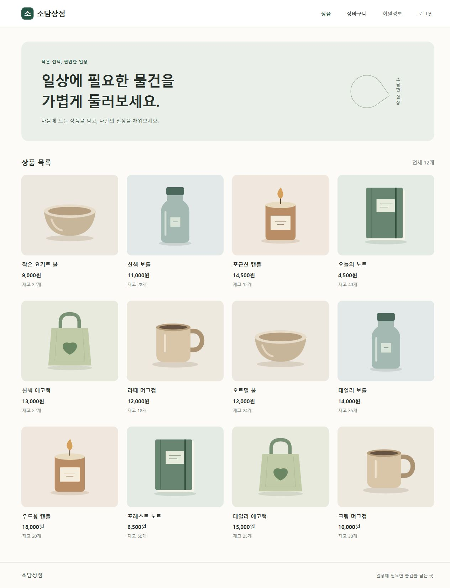
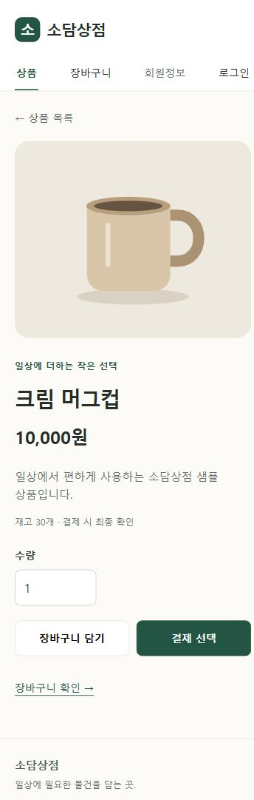
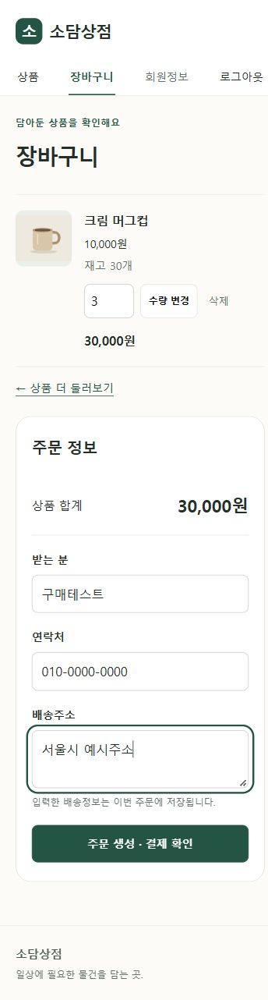
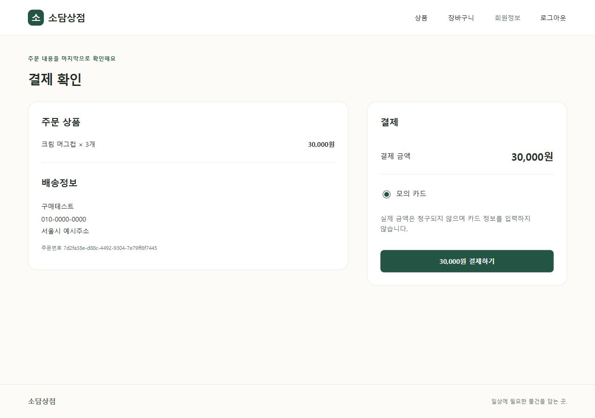
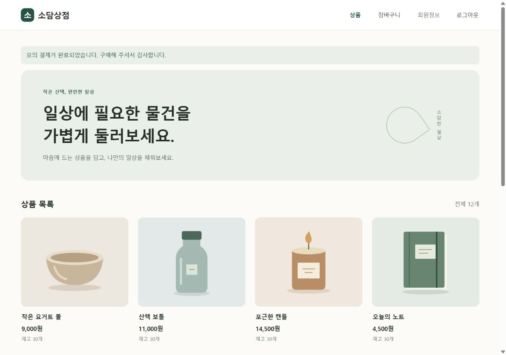

# 단계 4 결과 — 상품·장바구니·주문·모의 결제

단계 4 구현과 검증을 마쳤습니다. **단계 5는 다음 지시까지 진행하지 않습니다.**

## 이번 단계의 범위와 가정

- 상품 목록은 최신 등록순·페이지당 12개, 상세와 목록 모두 비로그인 조회가 가능합니다.
- 비회원 장바구니 저장·병합은 생략합니다. 결제 선택 URL의 상품·수량을 next로 유지하며 로그인 후 선택 화면으로 복귀합니다. 복귀만으로 상품을 담거나 결제하지 않습니다.
- 장바구니에는 여러 상품을 담고 수량 변경·삭제할 수 있습니다. 같은 상품은 기존 수량에 합산하며 최대 99개와 현재 재고를 확인합니다. 재고 예약은 하지 않습니다.
- 배송정보는 회원 기본값을 표시하고 주문 화면에서 필수 입력받습니다. 변경한 배송정보는 해당 주문에만 저장하며 회원정보를 덮어쓰지 않습니다.
- 모의 카드 한 종류를 사용하고 실제 카드정보·PG API·실제 청구는 없습니다. 모의 제공자는 기본 성공이며 거절·오류는 테스트에서 주입해 검증합니다.

## 실제 구현 흐름

아래는 테이블 관점의 흐름입니다. [Mermaid 원문](purchase-flow.mmd)을 제공합니다. 상품 재고 5개·단가 10,000원 예시는 설명용 값이며 샘플 상품 전체의 초기 재고는 seed.sql을 따릅니다.



## 주문·결제 무결성

- 주문 생성 요청은 cart_id와 서명된 확인값을 보냅니다. 확인값은 회원·장바구니·상품별 수량·현재 가격·이름에 연결되며 30분 유효합니다. 변경·위조·다른 회원의 확인값은 거부하고 재확인하게 합니다.
- 주문 생성부터 상품명·단가·수량·합계는 확정값입니다. 이후 상품 가격이 바뀌어도 과거 주문과 결제 금액을 유지합니다.
- 모든 변경은 회원 → 주문 → 상품 ID 오름차순으로 행을 잠급니다. 잠금 획득 후 기존 ORM 객체도 다시 읽어 오래된 재고·상태로 처리하지 않습니다.
- 결제 금액은 서버의 주문·항목에서 계산합니다. 클라이언트가 임의 amount나 다른 결제수단을 전송하면 입력 검증에서 거부합니다.
- 같은 주문의 중복 요청은 멱등키와 주문 상태를 함께 확인합니다. 같은 키는 기존 결과를 반환하고, 다른 키로 재요청해도 이미 성공한 주문에는 추가 성공 기록·차감이 없습니다.
- 실패한 결제 시도는 FAILED로 보존하고 재고·주문 상태는 유지합니다. 확정 실패 후 재시도에는 새 키를 사용합니다. 네트워크 오류에는 기존 키를 유지합니다.
- 재고·결제 성공·PAID 전환은 한 트랜잭션입니다. 중간 오류는 전체 롤백합니다. 실제 PG 전환 시에는 외부 호출을 이 트랜잭션에 넣지 않고 예약·웹훅·보상 설계가 필요합니다.
- 인증 세션이 없는 변경 API는 상태를 바꾸기 전에 401을 반환합니다. 인증된 변경 요청에는 기존 CSRF·Origin 검증을 그대로 적용합니다.

## 변경 파일과 이유

| 파일 | 목적 |
| --- | --- |
| app/services/shop.py | 상품·장바구니·주문·모의 결제 로직, 소유권·가격 확인·행 잠금·중복 방지 |
| app/schemas/shop.py | UUID·수량·배송정보·결제수단 입력 검증, 임의 필드 차단 |
| app/routers/products.py | 공개 상품 목록·페이지네이션·상세 |
| app/routers/cart.py | 인증 장바구니 화면과 추가·수정·삭제 API |
| app/routers/orders.py | 상품 선택 복귀·주문 생성·결제 확인 화면 |
| app/routers/payments.py | 모의 결제 API·멱등키 충돌 처리·완료 메시지 |
| app/routers/pages.py, app/main.py | 루트 이동, 라우터·오류 화면·원화 표시 연결 |
| app/core/auth.py, security.py | 오류 화면의 로그인 상태, 세션 없는 변경 API의 401 처리 |
| app/templates/products.html, product_detail.html | 실제 상품 카드·페이지 이동·수량 선택 |
| app/templates/selection.html, cart.html, checkout.html, error.html | 선택·장바구니·배송정보·결제·오류 화면 |
| app/templates/base.html | 실제 장바구니 메뉴 |
| app/static/js/shop.js | 수량·삭제·주문·결제 fetch 호출과 오류·재시도 처리 |
| app/static/css/style.css | 상품 그리드·상세·장바구니·결제 반응형 스타일 |
| app/static/images/*.svg | 직접 작성한 로컬 벡터 상품 이미지 7개 |
| db/seed.sql, app/core/seed_db.py | 샘플 상품 12개 INSERT, 기존 SKU는 수정하지 않고 건너뜀 |
| tests/test_shop.py | 수량·소유권·가격 변경·중복·실패·롤백 검증 |
| tests/auth_support.py, test_foundation.py | 전체 테이블 테스트 DB, DB 미설정 상품 화면 검증 |
| tests/check_shop_db.py | Supabase 구매 통합·실제 병렬 결제 검증 및 임시 행 정리 |
| tests/demo_data.py, preview_auth.py | Supabase와 분리된 브라우저 구매 검증 데이터 |
| README.md, docs/plan.md, docs/table-definition.md | 현재 단계·실행·배송정보 정책 반영 |
| docs/stage4.md, purchase-flow.mmd, screenshots/stage4-*.jpg | 결과·그래프·실제 캡처 |

db/schema.sql과 테이블 구조는 변경하지 않았습니다.

## 검증 결과와 DB 반영

- 자동 테스트 **35개 통과**, 의존성·Python 소스 점검 통과
- 실제 Supabase 구매 통합: 비회원 복귀·장바구니·주문·결제·중복 요청·재고 차감 확인 후 외부 트랜잭션 롤백
- 실제 별도 PostgreSQL 연결 2개를 병렬 실행: 마지막 재고 경쟁에서 성공 1건, 같은 키·다른 키로 같은 주문을 동시에 결제해도 차감 1회 확인
- 동시성 테스트는 별도로 생성한 회원·상품·주문만 사용하고 해당 UUID의 행들을 정리한 뒤 남지 않음을 확인
- 샘플 상품 **12개를 실제 Supabase에 추가**했습니다. 기존 회원·주문·상품 가격·재고를 변경하지 않았습니다. SKU가 이미 존재하면 건너뜁니다.
- 브라우저에서 비회원 결제 선택 → 가입·로그인 → 상품·수량 복귀 → 담기 → 수량 변경 → 배송정보 → 주문 생성 → 모의 결제 → 완료 메시지·목록 이동을 확인했습니다.
- 브라우저에서 상품 상세의 장바구니 담기와 항목 삭제·빈 장바구니 전환도 확인했습니다. 이 구매 테스트는 메모리 DB를 사용하여 실제 샘플 재고를 소모하지 않았습니다.
- 360px / 768px / 1280px 상품 목록과 결제 화면의 가로 넘침 없음, 360px 상품 상세·장바구니도 확인했습니다.

결제 완료 메시지는 서명 세션의 일회성 값입니다. URL 쿼리만 바꾸어 결제 완료로 표시하지 않습니다.

## 실행과 수동 테스트

[README](../README.md)에 로컬 서버 실행, 샘플 데이터, 실제 비회원 → 결제 → 로그인 → 이전 화면 복귀 절차를 정리했습니다. 테스트용 브라우저 서버는 메모리 DB를 사용하고 실제 앱은 .env의 Supabase를 사용합니다.

실제 DB 통합 검증 명령:

```powershell
.\.venv\Scripts\python.exe -m tests.check_shop_db
```

이 명령은 읽기 전용이 아닙니다. 검증용 UUID의 행만 생성·검증하고 롤백 또는 정리합니다. 실제 업무 데이터는 대상으로 삼지 않습니다.

## 화면











## 다음 단계

단계 5에서 회원정보·비밀번호 수정·탈퇴와 구매내역 목록·상세를 구현합니다. 현재 결제 확인 URL에서 해당 주문의 결제 완료 상태를 볼 수 있으나 구매내역 목록은 아직 구현하지 않았습니다.

참고: [PostgreSQL 행 잠금](https://www.postgresql.org/docs/current/explicit-locking.html), [SQLAlchemy 객체 다시 읽기](https://docs.sqlalchemy.org/en/20/orm/queryguide/api.html#populate-existing), [PostgreSQL 중복 INSERT 처리](https://www.postgresql.org/docs/current/sql-insert.html).

